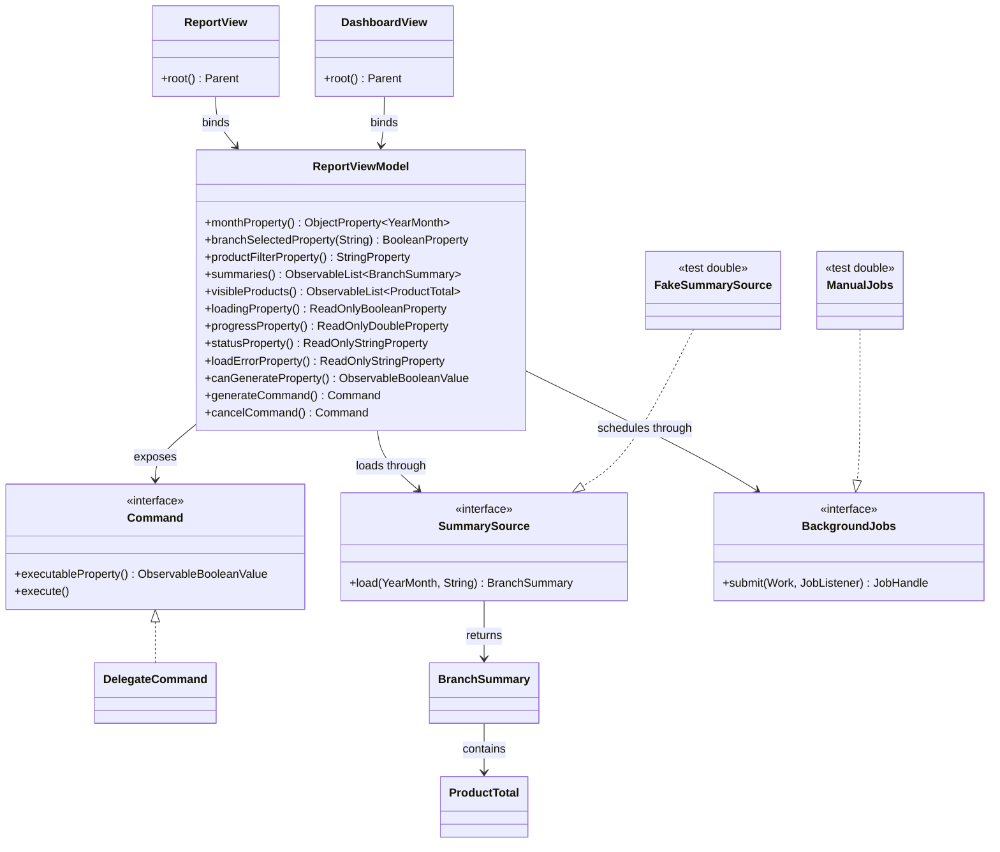

# Task 1: ViewModel design

## Lab 2 controller inventory

The Lab 2 implementation uses `ReportController`, `InputRules`, `SalesModel`, and a JavaFX view. The repository’s data and model packages are present; the controller is toolkit-free. The implementation below puts screen state and commands in `ReportViewModel`, keeps sales aggregation/loading behind `SummarySource`, and delegates scheduling to `BackgroundJobs`.

| Existing code / interaction | Concern | New owner |
|---|---|---|
| `ReportView.monthField` | Month text entry | View (bound to ViewModel month) |
| `ReportController.monthEntered` | Parse and validate month | ViewModel |
| `InputRules.month` | Month validity rules | ViewModel |
| `ReportView.branchBox` | Branch selection control | View (bound to ViewModel branch flag) |
| `ReportController.branchChosen` | Branch selection handling | ViewModel |
| `ReportController.execute(LoadMonth)` | Start monthly load | ViewModel command |
| `SalesModel.load` / `CsvMonthReader` | Read monthly transactions | Model via `SummarySource` |
| `SalesAggregator.summarize` | Calculate report totals | Model via `SummarySource` |
| `SalesModel.visibleTransactions` | Select report rows | Model |
| `ReportView.modelChanged` | Render table and chart | View (bindings) |
| `ReportView.showError` / `clearError` | Display load and validation state | ViewModel state, rendered by View |
| `SalesModelListener` | Notify view of model changes | Replaced by observable ViewModel properties |

## ViewModel members

| Group | Member | View may write? | Purpose |
|---|---|---:|---|
| Input | `monthProperty()` | Yes | Requested report month |
| Input | `branchSelectedProperty(branch)` | Yes | Selected branches |
| Input | `productFilterProperty()` | Yes | Case-insensitive product filter |
| Output | `summaries()` | No | Loaded branch summaries, exposed unmodifiable |
| Output | `visibleProducts()` | No | Filtered product totals, exposed unmodifiable |
| Output | `loadingProperty()` | No | Active-load indicator |
| Output | `progressProperty()` | No | Load progress fraction |
| Output | `statusProperty()` | No | User-facing load status |
| Output | `loadErrorProperty()` | No | Last load error |
| Output | `monthChoices()` | No | Last twelve months from injected clock |
| Computed | `monthErrorProperty()` | No | Month validation message |
| Computed | `branchErrorProperty()` | No | Branch-selection validation message |
| Computed | `validationMessageProperty()` | No | Combined validation text |
| Computed | `canGenerateProperty()` | No | Generate command availability |
| Computed | `totalRevenueProperty()` | No | Sum of loaded branch revenues |
| Computed | `totalRevenueTextProperty()` | No | Formatted chain revenue |
| Command | `generateCommand()` | No | Start loading selected branch reports |
| Command | `cancelCommand()` | No | Cancel the current load |
| Port | `SummarySource` | No | Model boundary for one-branch summary loading |
| Port | `BackgroundJobs` | No | Worker execution and UI-thread callbacks |

## Class diagram

## Repository adaptation

This Team 4 checkout already includes Lab 2’s `model`, `ingest`, and `engine` packages and the supplied root Maven project. Its original MVC controller has one branch selector and loads a whole month before selecting one branch. Task 1’s `SummarySource` is the intended per-branch port; its adapter can use `CsvMonthReader` and `SalesAggregator` without changing the existing model records. The legacy UI classes remain available as the comparison baseline.
